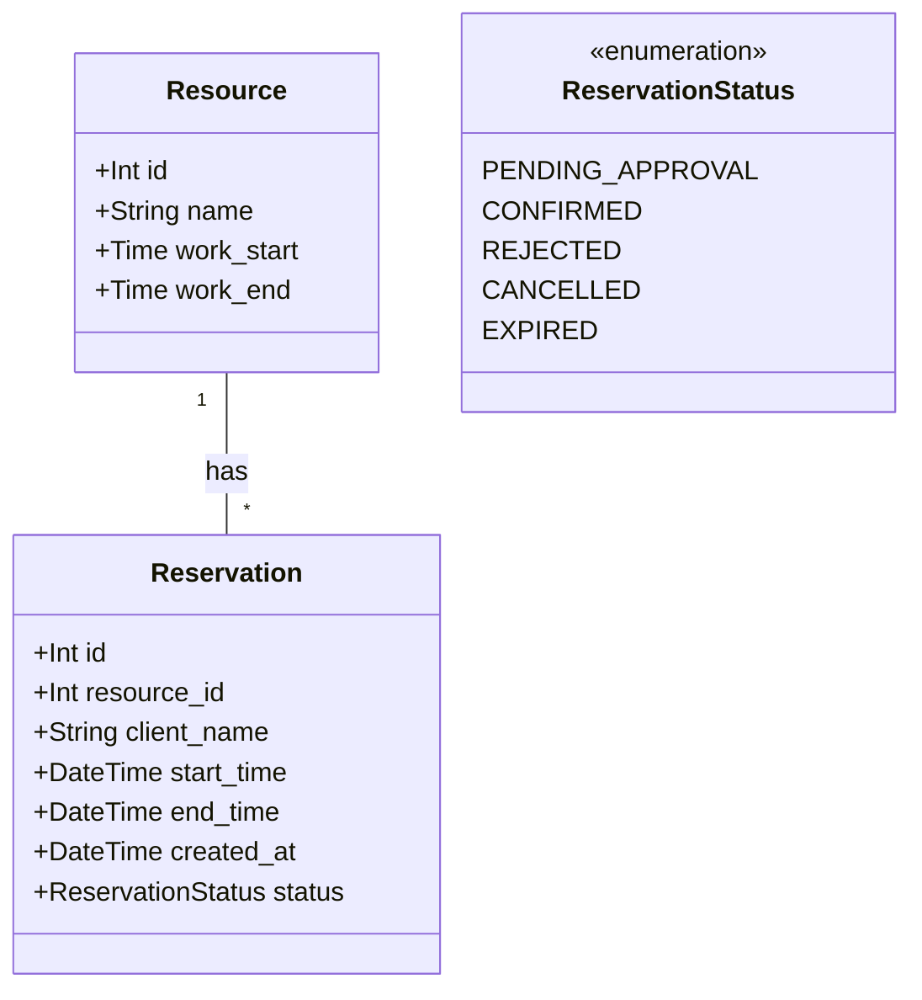
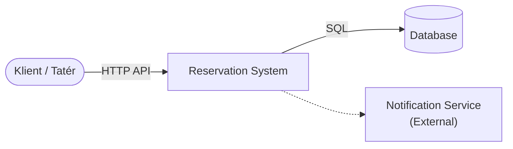
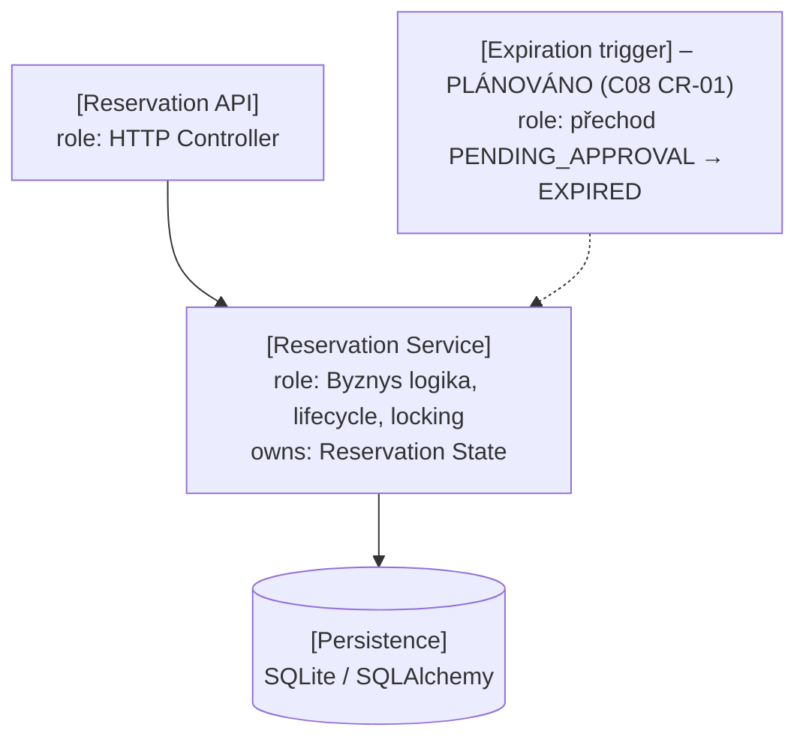
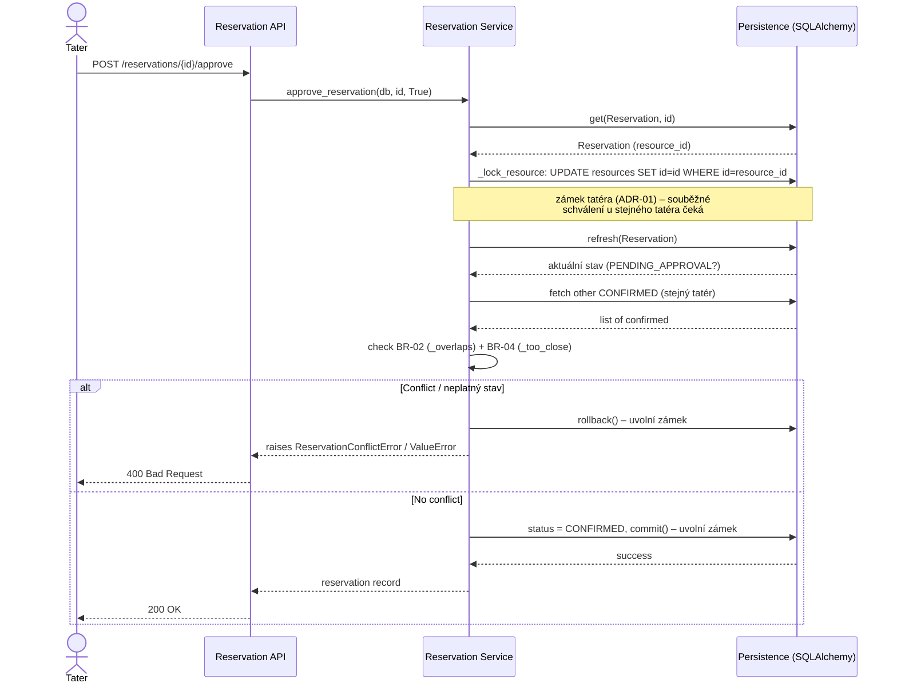
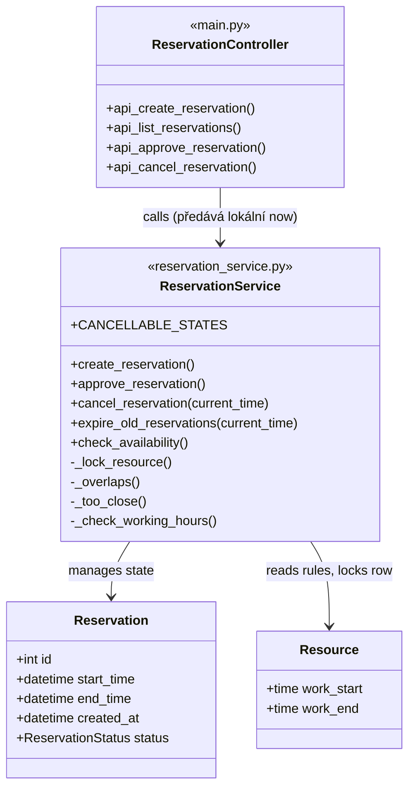

# Architecture and Decisions

## Zvolený stack
- **Jazyk:** Python 3.11+
- **Framework:** FastAPI
- **ORM / databáze:** SQLAlchemy + SQLite (pro C01 stačí, v případě potřeby
  lze bez velkých změn přepnout na PostgreSQL, protože SQLAlchemy
  abstrahuje konkrétní databázi)
- **Testování:** pytest

## Zdůvodnění
- FastAPI je jednoduché na naučení, má automatickou validaci vstupů
  (pomocí Pydantic) a rovnou generuje API dokumentaci (Swagger UI),
  což se hodí pro walking skeleton (POST /reservations).
- SQLite nevyžaduje žádnou instalaci navíc, takže je ideální pro
  reproducible build (spike C by šel snadno udělat) i pro rychlé
  ověření persistence (spike A).
- SQLAlchemy umožňuje definovat modely jako Python třídy, což je
  přehledné a odpovídá doménovému modelu z Project Frame.

Future pressure (Q/C/R/L) je definována v [intent-and-change.md](intent-and-change.md)
jako součást Project Frame.

---

## Dopad změny C02 (Přechod na Baseline v0.2)

**Změněná podmínka:** 
Některé zdroje (Tatér) vyžadují schválení oprávněnou osobou dříve, než se rezervace může stát CONFIRMED. Schválení může být opožděno, zamítnuto, nebo může vypršet.

**Dotčené požadavky / části specifikace:**
- **OP-01 (Create):** Po vytvoření klientem už rezervace nepřechází do DRAFT, ale do nového stavu `PENDING_APPROVAL` (čeká na vyjádření tatéra).
- **OP-03 (Confirm):** Samostatné potvrzování klientem jakožto operace OP-03 zaniká/slučuje se s procesem schválení. Potvrzení (CONFIRMED) se stává přímým důsledkem úspěšného schválení tatérem.
- **OP-04 (Cancel):** Musí být umožněno zrušit i rezervaci ve stavu `PENDING_APPROVAL`.

**Nedotčené požadavky / části + proč:**
- **OP-02 (Check Availability):** Nemění se. `PENDING_APPROVAL` stav zatím závazně neblokuje dostupnost (stejně jako původní DRAFT), aby systém umožnil souběžný sběr žádostí od vícero klientů pro stejný čas. Kapacitu blokuje až stav `CONFIRMED`.
- **Společná pravidla (BR-01 až BR-05):** Zůstávají stejná. Kolize, pauzy (BR-04) a čas zrušení (BR-03) se nadále počítají stejně.

**Nový aktér / operace, pokud vznikne:**
- Vzniká nová operace **OP-05 Approve Reservation** (Schválení rezervace). Oprávněným aktérem je Tatér. Tatér v ní žádost buď schválí (přejde do CONFIRMED), nebo zamítne (přejde do REJECTED).

**Změněná pravidla / význam stavů:**
- Místo stavu DRAFT se zavádí `PENDING_APPROVAL` (čeká na tatéra, neblokuje kapacitu exkluzivně).
- Přidán stav `REJECTED` (tatér žádost zamítl).
- Přidán stav `EXPIRED` (tatér nestihl zareagovat včas a požadavek vypršel).

**Změna diagramu případů užití:**
- Přibude cíl „Schválit žádost (Approve)“ pro aktéra Tatér.

**Změna stavového diagramu:**
- Místo DRAFT se zavádí PENDING_APPROVAL.
- Přibydou větve pro zamítnutí (REJECTED) a vypršení (EXPIRED).

**Nové příklady ověření:**
- Tatér schválí PENDING_APPROVAL → stav CONFIRMED.
- Tatér zamítne PENDING_APPROVAL → stav REJECTED.
- Uplyne 24 hodin bez reakce tatéra → stav EXPIRED.

**Architektonické drivery pro C03:**
- **Časovač / Background Job:** Systém musí obsahovat asynchronní proces (např. cron job nebo task queue), který bude pravidelně kontrolovat staré `PENDING_APPROVAL` žádosti a automaticky je překlápět do `EXPIRED`.
- **Externí notifikace:** Nutnost asynchronně posílat tatérovi upozornění na novou žádost ke schválení (Notification Service).

---

## C03 — Část A: AS-IS mapování scénáře Approve Reservation

> AS-IS stav k baseline v0.2 (kód před opravou C06 F1, commit `592ec1b` a starší). Odkazy míří na funkce, ne na čísla řádků. Současný stav po opravě popisují ADR-01 (revize), H1 a C05.

### A1. Jaký scénář sledujeme

Sledujeme operaci **Approve Reservation (OP-05)**, konkrétně schvalovací větev, kdy tatér žádost potvrdí (`is_approved=True`). Týká se požadavků **REQ-06** a **REQ-08**, vynucuje pravidla **BR-02** a **BR-04**, vše v rámci **Baseline v0.2**.

### A2. Jak hlavní průchod scénáře vypadá v kódu

Scénář má v aktuální implementaci API vstup a servisní část. Běžící FastAPI aplikace přijme HTTP požadavek v `api_approve_reservation()` v `src/main.py` a ta zavolá `approve_reservation()` v `src/reservation_service.py`. Demo skript `src/test_spike.py` volá servisní funkci přímo, bez HTTP vrstvy.

Jednotlivé kroky scénáře probíhají takto:

1. **Přijetí požadavku na schválení** — HTTP `POST /reservations/{res_id}/approve` zpracuje `api_approve_reservation()` v `src/main.py`; tělo požadavku obsahuje `is_approved`.
2. **Předání do aplikační logiky** — controller zavolá `approve_reservation(db, res_id, data.is_approved)` v `src/reservation_service.py`.
3. **Načtení rezervace** — `db.query(Reservation).get(reservation_id)`.
4. **Ověření, že přechod je povolený** — funkce zkontroluje, že rezervace existuje a je ve stavu `PENDING_APPROVAL`; jinak vyhodí `ValueError`.
5. **Vyhodnocení konfliktu (BR-02/BR-04)** — najdou se všechny `CONFIRMED` rezervace stejného tatéra a porovnají se pomocí `_overlaps()` a `_too_close()`.
6. **Změna stavu** — pokud žádný konflikt nenastal, `reservation.status` se přepíše na `CONFIRMED`.
7. **Uložení a odpověď** — `db.commit()` a `db.refresh(reservation)` uloží výsledek; controller vrátí JSON s `id` a `status`. `ReservationConflictError` nebo `ValueError` controller převede na HTTP 400.

### A3. Jedna důležitá chybová větev: konflikt při schvalování

Co se stane, když tatér chce schválit žádost, ale mezitím už potvrdil jinou rezervaci na stejný/kolidující čas?

- **Co k tomu říká v0.2:** při kolizi se schválení zamítne (OP-05, alternativní výsledky).
- **Kde se to pozná:** přímo v `approve_reservation()` — dotaz na existující `CONFIRMED` rezervace a test `_overlaps()`/`_too_close()` ve smyčce přes `other_confirmed`.
- **Kde se rozhodne výsledek:** na stejném místě — jakmile se najde konflikt, hned se vyhodí `raise ReservationConflictError(...)`, ještě před jakýmkoliv zápisem do databáze.
- **Co dostane volající:** při přímém volání service funkce Python výjimku `ReservationConflictError`; přes HTTP endpoint ji `api_approve_reservation()` převede na HTTP 400 s textem chyby. Rezervace samotná zůstane ve stavu `PENDING_APPROVAL`, protože k `db.commit()` se vůbec nedostane.

**Rozdíl mezi specifikací a implementací, který jsme při tom objevili:**
Specifikace (`docs/spec/reservation-approve.md`, řádek 39) píše, že při kolizi "rezervace **může být tatérem rovnou zamítnuta**" — tedy že po neúspěšném schválení by mohlo/mělo logicky následovat zamítnutí (přechod do `REJECTED`). Kód to ale takhle nedělá: po vyhození výjimky se nic automaticky nezmění, rezervace zůstává viset v `PENDING_APPROVAL`. Aby se dostala do `REJECTED`, musí někdo zavolat `approve_reservation()` znovu, tentokrát s `is_approved=False` (větev `if not is_approved`). Automatická návaznost mezi "konflikt" a "zamítnuto" v kódu chybí.

### A4. Hlavní části implementace, které scénář realizují

Scénář prochází pěti částmi kódu:

- **Reservation API / Controller** — `api_approve_reservation()` v `src/main.py`. Přijme HTTP command, získá databázovou session přes `Depends(get_db)`, zavolá service a vytvoří HTTP/JSON odpověď.
- **Reservation Service** — modul `src/reservation_service.py`, funkce `approve_reservation`, `_overlaps`, `_too_close`. Ověří přechod, zkontroluje konflikt a rozhodne o výsledku.
- **Reservation Domain Model** — třídy `Reservation` a `ReservationStatus` v `src/models.py`. Nesou stav a data rezervace, které se v tomto scénáři mění.
- **Persistence** — `sqlalchemy.orm.Session`, který service používá přímo (`db.query`, `db.commit`, `db.refresh`). Samostatná repository třída v projektu není.
- **Direct Demo Entry Point** — `main()` v `src/test_spike.py` umožňuje stejnou service funkci ověřit přímo, bez API. Není součástí běžného HTTP průchodu.

### A5. Kde je stav, kde se mění a kde se vynucuje pravidlo

**Stav rezervace** je trvale uložen ve sloupci `status` (typ `Enum(ReservationStatus)`) v tabulce `reservations` v SQLite databázi. Běžící API používá `tattoo_studio.db` (engine v `main.py`), zatímco demo používá `spike_test.db` (engine v `test_spike.py`). O přechod `PENDING_APPROVAL → CONFIRMED` se stará jen jedna funkce — `approve_reservation()` v `reservation_service.py`, která zároveň rozhoduje (kontroluje konflikt) i provádí zápis.

**Pravidlo BR-02** (dvě `CONFIRMED` rezervace stejného tatéra se nesmí překrývat) se v tomto scénáři zjišťuje a vyhodnocuje na stejném místě — v `approve_reservation()` (smyčka přes `other_confirmed`). Důležité zjištění: **stejná kontrola konfliktu je v kódu duplikovaná na třech místech** — kromě `approve_reservation()` ještě v `create_reservation()` a v `check_availability()` (tam jen informativně, bez zápisu). Výsledná změna stavu (zápis `CONFIRMED`) se ale provádí jen v `approve_reservation()` (`reservation.status = ReservationStatus.CONFIRMED`).

### A6. Jaké závislosti scénář skutečně používá

- **Databáze (SQLite):** v běžící FastAPI aplikaci `src/main.py` vytváří engine nad `sqlite:///./tattoo_studio.db`; service dostává `db: Session` jako parametr a pracuje s ním přímo (`db.query/.commit/.refresh`). Mapování na tabulky definuje `src/models.py`. Žádná vlastní repository vrstva mezi service a SQLAlchemy není.
- **Demo databáze (SQLite):** `src/test_spike.py` používá oddělené `sqlite:///spike_test.db` pro demonstrační běh a ověřuje service funkci přímým voláním. Nejde o databázi používanou běžícím FastAPI endpointem.
- **Notification Service:** v kódu tohoto scénáře se **nikde nevolá** — je to jen plánovaný budoucí driver zmíněný výše v tomto dokumentu, reálně zatím neimplementovaný.
- **IdP / autentizace:** také **se nepoužívá** — `approve_reservation()` nijak nekontroluje, kdo volání dělá; kdokoliv se znalostí `reservation_id` může schválení/zamítnutí provést.

### A7. AS-IS strukturální diagram

```
+---------------------------- Application code -----------------------------+
|                                                                            |
|  [Reservation API / Controller]                   (function)              |
|  role: přijme HTTP approve command a vrátí JSON/HTTP výsledek              |
|          | approve_reservation(id, is_approved)                           |
|          v                                                                 |
|  [Reservation Service]                            (module)                |
|  role: ověří přechod, zkontroluje BR-02/BR-04 a rozhodne                   |
|          | load/save Reservation                                         |
|          v                                                                 |
|  [Reservation Domain Model]                      (classes)                |
|  role: nese stav ReservationStatus a data rezervace                       |
|          | SQLAlchemy mapping                                             |
|          v                                                                 |
|  [Persistence: SQLAlchemy Session]               (framework object)       |
|  role: provádí SELECT, UPDATE, commit a refresh                           |
|                                                                            |
+----------------------------------------------------------------------------+
        | SQL read/write (SELECT / UPDATE)
        v
 [SQLite DB: tattoo_studio.db]                         (database)
```

```
Reservation API / Controller:
- main.py: api_approve_reservation

Reservation Service:
- reservation_service.approve_reservation
- reservation_service._overlaps
- reservation_service._too_close

Reservation Domain Model:
- models.Reservation
- models.ReservationStatus

Persistence:
- main.py: get_db, SessionLocal, engine
- sqlalchemy.orm.Session (db)

Direct Demo Entry Point:
- test_spike.py: main() (pouze ověřovací/demo průchod)
```

### A8. Otázka pro další C03

**Otázka:** Mohou dva souběžné požadavky na schválení dvou kolidujících `PENDING_APPROVAL` rezervací stejného tatéra oba projít kontrolou konfliktu a oba skončit jako `CONFIRMED`?

**Doklad:** V `approve_reservation()` jsou kontrola kolize (dotaz na `CONFIRMED` rezervace do `other_confirmed`) a zápis nového stavu (`db.commit()`) dva oddělené kroky. Mezi nimi není žádný zámek, transakční izolace typu "SELECT ... FOR UPDATE" ani verzovací sloupec, které by druhému souběžnému volání zabránily proklouznout mezitím.

**Proč je důležitá:** BR-02 musí platit i při souběžném schvalování dvou kolidujících žádostí na stejný čas. Samotná specifikace pravidel (`docs/spec/reservation-rules.md`, řádky 24–25) tuto situaci přímo zmiňuje — "při souběžném potvrzování kolidujících návrhů může uspět nejvýše jeden pokus" — ale implementace žádný mechanismus, který by to zaručil, zatím neobsahuje.

---

## C03 (pokračování, 4. cvičení) — Část B–M: TO-BE Architektura a Rozhodnutí

> Pozn.: tato sekce se dříve jmenovala „C04 — Část B–M“. Obsahově jde o pokračování C03, zadání C04 Quality & Measurement v tomto běhu kurzu nebylo.

### B. Architektonické drivery

| Podklad / zdroj | Proč ovlivňuje architekturu | Otázka, kterou musí architektura vyřešit |
| :--- | :--- | :--- |
| BR-02, REQ-04, Part A (souběh) | Dva souběžné requesty mohou oba vidět „bez konfliktu“ před zápisem. | Kde a jak se musí udělat autoritativní lock/decision, aby BR-02 zůstalo pravdivé? |
| REQ-07 (Vypršení času) | Stav PENDING_APPROVAL musí přejít po 24h do EXPIRED bez akce uživatele. | Kdo vlastní expiraci a jaký mechanismus provede pozdější transition? |
| Notification Boundary | Notifikace může selhat (síťový výpadek). | Má failure notifikace změnit výsledek schválení (rollback) a kdo řeší retry? |

### C1. Doménový třídní model



### C2. Odpovědnosti systému

| Zdroj | Odpovědnost | Co musí rozhodovat / vlastnit | Potřebuje jednoho jasného vlastníka? | Důvod |
| :--- | :--- | :--- | :--- | :--- |
| Confirm + BR-02 | Vyhodnotit konflikt a schválit rezervaci | Lifecycle transition (CONFIRMED/REJECTED) a DB lock | ano | Různé procesy nesmí obejít kontrolu kolize |
| API | Zpracovat HTTP vstup | Formát HTTP odpovědi (REST) | ano | Oddělení webové vrstvy od byznys logiky |
| REQ-07 | Kontrola expirace (Background Job) | EXPIRED state transition | ano | Časovač musí fungovat nezávisle na HTTP requestech |
| Notifikace | Doručit notifikaci tatérovi/klientovi | Odeslání do externí API | ano | Externí failure nesmí rozbít zápis rezervace do DB |

### D. Rozhodovací otázka
**Kde a jak má být provedeno `confirmation decision` tak, aby při souběhu dvou schválení na stejný čas platilo BR-02 (Exclusive Resource)?**

### E1. Alternativy

**Alternativa A — Application-level Locking (Mutex / In-memory lock)**
Zámek se bude řešit v paměti Python aplikace (např. přes `asyncio.Lock`). 

**Alternativa B — Database-level Pessimistic Locking (SELECT ... FOR UPDATE)**
Kontrola kolizí a zápis stavu bude chráněn transakčním zámkem přímo v databázi, takže DB nepustí dvě souběžné transakce měnit rezervace stejného tatéra přes sebe.

### E2. Porovnání alternativ vůči driverům

| Driver / kritérium | Alternativa A (App-level lock) | Alternativa B (DB-level lock) |
| :--- | :--- | :--- |
| Konzistence při souběhu (BR-02) | Bude fungovat jen dokud běží 1 instance API. Pokud nasadíme 2 instance, nezabrání to kolizi. | Konzistenci zaručí databáze nezávisle na počtu API instancí – **za podmínky, že zámek skutečně serializuje kolidující rozhodnutí** (viz revize ADR-01: na SQLite nestačí `with_for_update()`). |
| Provozní složitost | Velmi jednoduché na kód, nezatěžuje DB, ale špatně škáluje. | Vyžaduje specifický SQL příkaz (v SQLAlchemy `with_for_update()`), mírně delší zámek na tabulce. |

### F. ADR

## ADR-01 — Konkurenční přístup ke schvalování (Concurrency & Locking)

- **Kontext:** V Part A jsme zjistili, že `approve_reservation` nemá ochranu proti race-condition. Dva tatéři (nebo chybný UI retries) mohou schválit dvě kolidující žádosti přesně ve stejnou milisekundu.
- **Drivery:** BR-02 (Exclusive Resource), Data consistency.
- **Alternativa A:** Application-level lock.
- **Alternativa B:** Database-level lock (Pessimistic Locking `FOR UPDATE`).
- **Rozhodnutí:** Volíme **Alternativu B**.
- **Důvod:** Databáze je u rezervačních systémů jediný skutečný zdroj pravdy (SSOT). Uzamčení řádků pomocí transakce zaručí BR-02 i při horizontálním škálování aplikace.
- **Přijaté negativní důsledky:** Mírně horší propustnost při masivním paralelním schvalování (transakce musí čekat ve frontě databáze), což pro tetovací studio není úzké hrdlo.
- **Rozhodnutí znovu otevřeme, když:** Databáze se stane kritickým bottleneckem a budeme muset přejít na asynchronní event-sourcing / optimistické zamykání.

### ADR-01 — Revize po C06 (F1)

- **Status:** Accepted, implementováno v commitu `78c4c87` (větev `fix/c06-findings`). Na assessed baseline `592ec1b` rozhodnutí v kódu chybělo (C06 F1, A4 = NO).
- **Co se změnilo proti původnímu znění:** Původní návrh `query(Reservation).with_for_update().get(id)` by BR-02 nezaručil ze dvou důvodů:
  1. SQLite (náš runtime, G4) `SELECT ... FOR UPDATE` nepodporuje, SQLAlchemy klauzuli pro dialekt sqlite vynechá → žádný zámek;
  2. zamyká jen schvalovanou rezervaci, ne kolidující rezervace stejného tatéra – dvě různé kolidující žádosti by se navzájem neblokovaly.
- **Upřesněné rozhodnutí (stále Alternativa B – DB-level):** Zamyká se **řádek tatéra (`Resource`)**, tj. serializují se všechna rozhodnutí o rezervacích jednoho tatéra. Prvním příkazem transakce v `approve_reservation()` je no-op zápis `UPDATE resources SET id = id WHERE id = :resource_id` (`_lock_resource()` v `reservation_service.py`):
  - SQLite: zápis na začátku transakce získá databázový zápisový zámek (stejný efekt jako `BEGIN IMMEDIATE`); souběžná transakce čeká (busy timeout) až do `commit`/`rollback`;
  - PostgreSQL apod.: `UPDATE` zamkne řádek tatéra do konce transakce – stejný kód funguje i po přechodu z SQLite.
- **Pořadí uvnitř transakce:** načíst rezervaci → zamknout tatéra → znovu načíst stav (`db.refresh`) → ověřit `PENDING_APPROVAL` → kontrola BR-02/BR-04 → zápis → `commit` (uvolní zámek). Při jakékoli chybě `rollback` (uvolní zámek, stav beze změny).
- **Proč ne ruční `BEGIN IMMEDIATE`:** se SQLAlchemy Session a ovladačem pysqlite je křehké (selže, pokud už transakce běží) a není přenositelné na jinou DB.
- **Přijaté negativní důsledky:** na SQLite se serializují všechny zápisy do DB, ne jen jednoho tatéra (pro tetovací studio zanedbatelné). Zámek se bere jen v `approve_reservation()` – `create_reservation()` stav `CONFIRMED` nevytváří, takže BR-02 neohrožuje.
- **Evidence:** `test_F1_concurrent_approve_of_colliding_requests_at_most_one_confirmed` (`src/test_c06_regression.py`) – na `592ec1b` FAIL (obě `CONFIRMED`), po opravě PASS; s vypnutým `_lock_resource` znovu FAIL (test opravdu ověřuje zámek). Regrese: `test_F1_adjacent_request_with_pause_can_still_be_approved`.

### G. TO-BE Architektura

**G1. Context Diagram**


**G2. Static Architecture**


> Stav k `78c4c87`: Expiration trigger **neexistuje** – `expire_old_reservations()` v service je implementovaná, ale nic ji nevolá (ani API, ani job). Automatická expirace (REQ-07) je zpracovaná jako Change Request CR-01 v C08 (`docs/intent-and-change.md`). Čárkovaná šipka = plánovaná vazba.

**G3. Statechart Ownership**
| Přechod | Owner rozhodnutí | Kdo může transition pouze vyžádat | Stav implementace |
| :--- | :--- | :--- | :--- |
| [*] → PENDING_APPROVAL (create) | Reservation Service (`create_reservation`) | Klient (API) | ANO |
| PENDING_APPROVAL → CONFIRMED | Reservation Service (`approve_reservation`, pod zámkem tatéra – ADR-01) | Tatér (API) | ANO od `78c4c87` |
| PENDING_APPROVAL → REJECTED | Reservation Service (`approve_reservation`, `is_approved=False`) | Tatér (API) | ANO |
| PENDING_APPROVAL / CONFIRMED → CANCELLED | Reservation Service (`cancel_reservation`, guard stavu + `now < start`) | Klient / Tatér (API) | ANO od `78c4c87` (F2, F3) |
| PENDING_APPROVAL → EXPIRED | Reservation Service (`expire_old_reservations`) | Expiration trigger | ČÁSTEČNĚ – funkce existuje, trigger chybí (CR-01) |

**G4. Runtime / Deployment**
Aplikace běží v jednom uvicorn worker procesu, napojená na SQLite databázový soubor. FastAPI obsluhuje synchronní endpointy v threadpoolu, takže i jeden proces zpracovává requesty souběžně – proto je nutný zámek z ADR-01. Všechny časy (`start_time`, `end_time`, `created_at`, „now“ v API) jsou **lokální naivní čas serveru**; předpoklad: server i klienti v časové zóně Europe/Prague (rozhodnutí k C06 F3).

### H. Návrhový model

**H1. Design Sequence Diagram (OP-05 Approve – TO-BE, implementováno v `78c4c87`)**


### J. AS-IS → TO-BE Delta

| Oblast | AS-IS | TO-BE | Akce |
| :--- | :--- | :--- | :--- |
| Locking (BR-02) | Chybí ochrana | Zámek tatéra v `approve_reservation()` (revize ADR-01) | **CHANGE** – hotovo v `78c4c87` |
| Notifikace | Žádné | Modul připraven | KEEP (mimo scope C03) |
| Expirace (REQ-07) | `expire_old_reservations()` existuje, nic ji nevolá (ani skript v produktu, jen demo `test_spike.py` a unit test) | Trigger expirace – varianta se rozhoduje v C08 CR-01 | **DEFER → C08 CR-01** |

### M. Evidence C03

- **AS-IS → TO-BE delta:** Rozhodnuto o zavedení pesimistického zamykání v databázi pro zaručení pravidla BR-02 při souběžném schvalování.
- **Implementation changes:** Na assessed baseline `592ec1b` zámek **chyběl** (C06 F1). Doplněn v `78c4c87` jako zámek řádku tatéra (`_lock_resource()`), viz revize ADR-01.
- **Behaviour verification:** Původní tvrzení „otestováno na manuálních HTTP požadavcích“ nemělo uložený důkaz – nahrazeno automatizovanými testy: `test_reservation_service.py` (C05, 6 testů) a `test_c06_regression.py` (11 testů, mj. souběžné schválení). Výsledky viz `docs/evidence-and-evolution.md` § C06.
- **Remaining uncertainty / risk:** Notifikace stále fungují jen jako placeholder, reálná integrace přinese nové drivery. Automatická expirace chybí (CR-01). Kontrolu dostupnosti (OP-02) v běžícím produktu dělá frontend, ne Reservation Service – známá odchylka, viz níže.

### N. Známá odchylka architektury: Check Availability (OP-02)

| Architektura / spec | Skutečnost (`78c4c87`) | Rozhodnutí |
| :--- | :--- | :--- |
| Pravidlo dostupnosti vlastní Reservation Service (`check_availability()`), blokuje jen `CONFIRMED` (REQ-02, `diagrams.md` – Availability vs. Approve) | API nemá endpoint pro dostupnost, `check_availability()` je v `main.py` jen importovaná. Sloty počítá frontend (`frontend/src/App.jsx`, `isColliding`) a blokuje i `PENDING_APPROVAL`; navíc nedovolí rezervaci dříve než 24 h dopředu (pravidlo, které spec nemá). | **Vědomě ponecháno, zapsáno jako odchylka a riziko** (C06 A2). Backend při create/approve pravidla BR-02/BR-04 vynucuje sám, takže invariant není ohrožen – frontend je jen přísnější. Náprava (endpoint `GET /availability` + napojení UI) je kandidát na další CR. |


## C05 Detailed Design

> Revize po C06 (větev `docs/c06-c08-sync`): doplněny kontrakty Approve/Cancel/Expire, guardy stavů, časová báze a souběh. Původní verze tvrdila soulad s kódem, C06 ale potvrdilo neshody F1–F3 – viz `docs/evidence-and-evolution.md` § C05 a § C06.

**Selected architecture unit:** Reservation Logic (`src/reservation_service.py`)
**Related scenario(s):** Create Reservation (OP-01), Approve Reservation (OP-05, nahradila zaniklou Confirm OP-03), Cancel Reservation (OP-04), Expire Reservation (REQ-07)
**Relevant business rule(s):** BR-01 (Interval semantics), BR-02 (Exclusive Resource invariant), BR-03 (Cancellation policy), BR-04 (Minimální pauza), BR-05 (Pracovní doba)

**Detailed responsibilities:**
| Detailed responsibility | Why is it needed? |
|---|---|
| Validate time constraints | Rezervace nesmí být v minulosti a musí respektovat pracovní dobu tatéra (BR-01, BR-05). |
| Check resource availability | Zamezení konfliktů (překryvů a dodržení 30minutové pauzy) mezi potvrzenými rezervacemi stejného tatéra (BR-02, BR-04). |
| Manage reservation lifecycle | Bezpečný přechod stavů – povolené jsou jen přechody ze stavového diagramu 9b (`diagrams.md`); `CANCELLED`, `REJECTED`, `EXPIRED` jsou koncové. |
| Serialize confirmation decisions | Při souběžném schvalování kolidujících žádostí smí uspět nejvýše jedna (REQ-04, ADR-01). |
| Use one time base | Všechna časová porovnání (`now` vs. `start_time`, `created_at`) musí být ve stejné časové bázi, jinak se hranice BR-03 / REQ-07 posunou. |

**Design elements and ownership:**
| Responsibility | Owner | State/data | Why here? |
|---|---|---|---|
| Business rules & Validation | `reservation_service` (Module) | N/A (Stateless) | Centrální místo pro veškerou doménovou logiku izolované od HTTP vrstvy (ověřeno architektonickým testem). |
| Lifecycle guards | `reservation_service` – `approve_reservation`, `cancel_reservation` (`CANCELLABLE_STATES`), `expire_old_reservations` | `Reservation.status` | Každý přechod má jednoho ownera – stejná funkce rozhoduje i zapisuje. |
| Concurrency control | `reservation_service._lock_resource` | zámek řádku `Resource` v DB transakci | DB je SSOT (ADR-01); zámek patří k funkci, která rozhoduje o `CONFIRMED`. |
| Reservation State | `Reservation` (Entity) | `ReservationStatus`, `created_at` | Datový model vlastněný databází (SQLAlchemy), uchovává stav rezervace. |
| Resource State | `Resource` (Entity) | Pracovní doba | Definuje hranice dostupnosti pro daného tatéra; jeho řádek slouží jako zámek. |
| Zdroj času („now“) | volající: API (`main.py`, `datetime.now()`), testy injektují | – | Service dostává `current_time` jako parametr → testovatelné hranice; API musí předat **lokální** čas. |

**Key interface(s) / contract(s):**

`create_reservation(db: Session, resource_id: int, client_name: str, start_time: datetime, end_time: datetime) -> Reservation`
*   **Preconditions:** `start_time` < `end_time`, `start_time` je v budoucnosti (lokální čas), existuje `Resource`.
*   **Postcondition:** Vytvořena rezervace ve stavu `PENDING_APPROVAL`, `created_at` = lokální čas vytvoření.
*   **Failures:** `ValueError` (neexistující resource, špatný čas), `OutsideWorkingHoursError` (mimo pracovní dobu), `ReservationConflictError` (kolize s jinou `CONFIRMED` rezervací).

`approve_reservation(db: Session, reservation_id: int, is_approved: bool) -> Reservation`
*   **Preconditions:** rezervace existuje a je ve stavu `PENDING_APPROVAL` (ověřuje se **až po získání zámku**).
*   **Postcondition:** `is_approved=True` → `CONFIRMED` a BR-02/BR-04 platí pro všechny `CONFIRMED` rezervace tatéra; `is_approved=False` → `REJECTED`.
*   **Failures:** `ValueError` (neexistuje / neplatný zdrojový stav), `ReservationConflictError` (překryv nebo chybí pauza). Při chybě se stav nemění (rollback).
*   **Concurrency:** kontrola a zápis probíhají v jedné transakci pod zámkem tatéra – ze dvou souběžných kolidujících schválení uspěje nejvýše jedno.

`cancel_reservation(db: Session, reservation_id: int, current_time: datetime) -> Reservation`
*   **Preconditions:** rezervace existuje; stav ∈ {`PENDING_APPROVAL`, `CONFIRMED`}; `current_time < start_time` (obojí lokální čas).
*   **Postcondition:** stav `CANCELLED`, rezervace přestane blokovat dostupnost. Je-li už `CANCELLED` → úspěch beze změny (idempotence).
*   **Failures:** `ValueError` – neexistuje; stav `REJECTED`/`EXPIRED` (koncové stavy); `current_time >= start_time`.

`expire_old_reservations(db: Session, current_time: datetime) -> int`
*   **Preconditions:** `current_time` je lokální čas (stejná báze jako `created_at`).
*   **Postcondition:** každá `PENDING_APPROVAL` s `created_at <= current_time - 24 h` je `EXPIRED`; vrací počet změněných.
*   **Failures:** žádné doménové. **Pozn.:** v produktu ji zatím nic nevolá – trigger je předmětem C08 CR-01.

**Focused structural view:**

Pozn.: `check_availability()` API zatím nepoužívá (známá odchylka, sekce N).

**Detailed sequence:**
*Create Reservation Sequence:*
`FastAPI Route` -> `ReservationService.create_reservation()`
-> `_check_working_hours(Resource)`
-> DB query for `CONFIRMED` reservations
-> `_overlaps()` / `_too_close()` validations
-> DB save -> returns `Reservation`

*Approve Reservation Sequence (ADR-01):*
`api_approve_reservation` -> `approve_reservation()`
-> `get(Reservation)` -> `_lock_resource(resource_id)` -> `refresh(Reservation)`
-> guard `PENDING_APPROVAL`
-> DB query for other `CONFIRMED` -> `_overlaps()` / `_too_close()`
-> `CONFIRMED` / `REJECTED` -> `commit()` (uvolní zámek); při chybě `rollback()`
(diagram viz H1)

**Important methods / operations:**
*   **Operation:** `approve_reservation`
*   **Responsibility:** Tatér schvaluje nebo zamítá čekající rezervaci.
*   **Side effects:** po dobu transakce drží zámek tatéra.
*   **Failure behavior:** Vyhodí `ValueError`, pokud rezervace není ve stavu `PENDING_APPROVAL`. Vyhodí `ReservationConflictError`, pokud v mezičase vznikla kolizní `CONFIRMED` rezervace. V obou případech rollback, stav beze změny.

*   **Operation:** `cancel_reservation`
*   **Responsibility:** Zrušení rezervace podle BR-03.
*   **Failure behavior:** viz kontrakt; pořadí kontrol je rozhodnutí DD (viz decision table).

**Algorithm / decision logic:**
*Conflict Detection Logic:*
```python
for existing in confirmed_reservations:
    if start_a < end_b and start_b < end_a: 
        raise Conflict # Přímý překryv
    if gap_after_a < 30_mins or gap_after_b < 30_mins:
        raise Conflict # Porušení hygienické pauzy
```

*Cancel decision table (BR-03, stavový diagram 9b):*
| # | Rezervace existuje | Stav | `now < start` | Výsledek |
|---|---|---|---|---|
| 1 | ne | – | – | `ValueError` (neexistuje) |
| 2 | ano | `CANCELLED` | libovolně | úspěch, beze změny (idempotence má přednost před časem) |
| 3 | ano | `REJECTED` / `EXPIRED` | libovolně | `ValueError` (koncový stav), beze změny |
| 4 | ano | `PENDING_APPROVAL` / `CONFIRMED` | ne (`now >= start`) | `ValueError` (čas začátku nastal), beze změny |
| 5 | ano | `PENDING_APPROVAL` / `CONFIRMED` | ano | `CANCELLED` |

**DD decisions intentionally left to code:**
Helper metody `_overlaps` a `_too_close` jsou implementovány jako privátní funkce modulu, nevytváříme pro ně zbytečné Value Objects nebo samostatné kalkulátory. Databázové dotazy jsou realizovány přímo přes SQLAlchemy Session, nevytváříme abstraktní Repository pattern, protože aplikace je malá. Konkrétní SQL podoba zámku (no-op `UPDATE`) je detail `_lock_resource()`; DD závazně určuje jen to, že se zamyká tatér a že kontrola i zápis jsou v jedné transakci.
