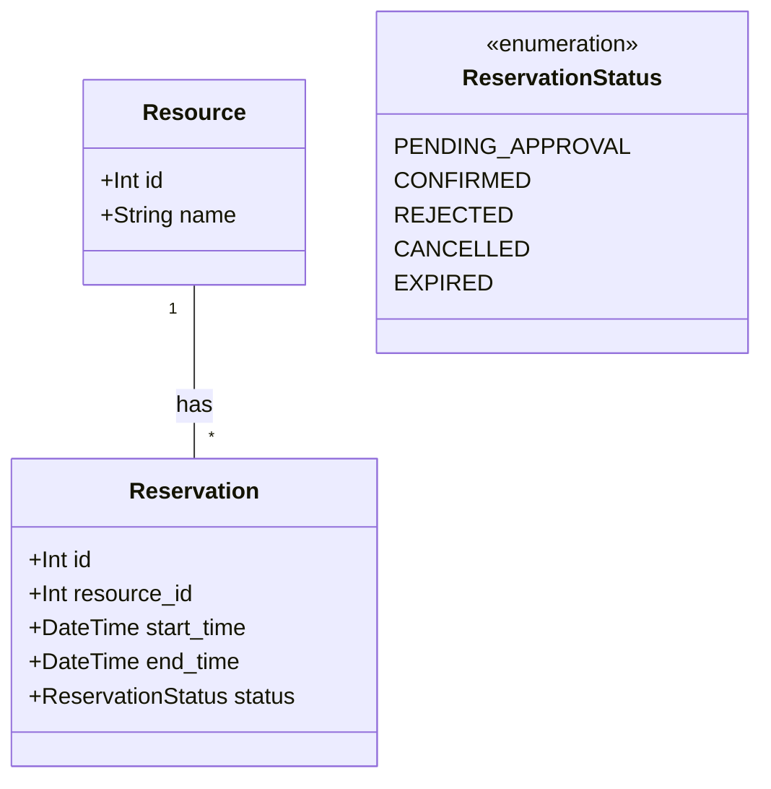
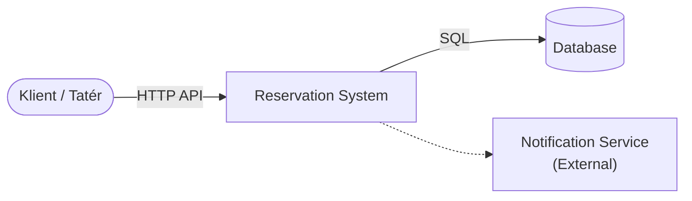
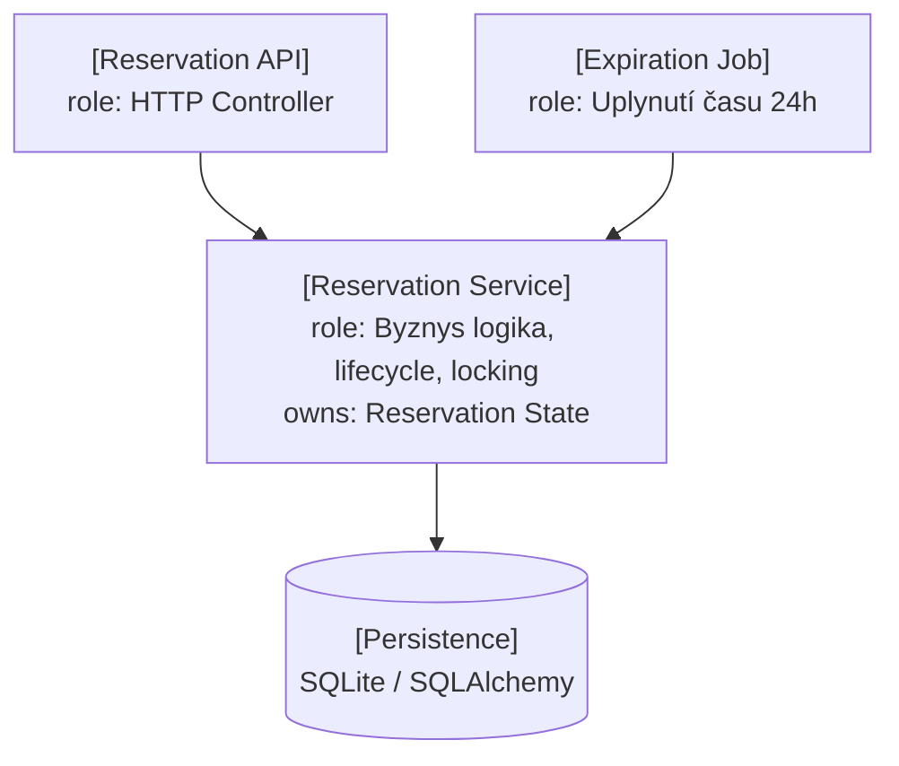
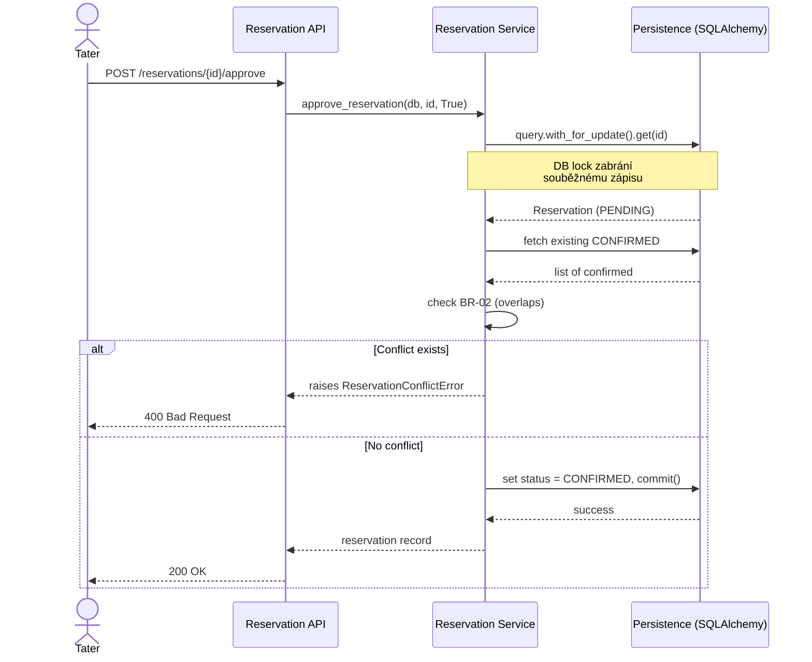
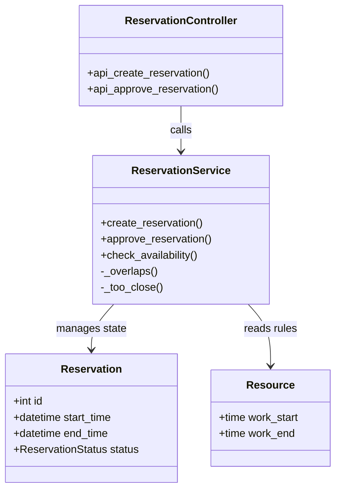

# Architecture and Decisions

## Zvolený stack
- **Jazyk:** Python 3.11+
- **Framework:** FastAPI
- **ORM / databáze:** SQLAlchemy + SQLite (pro C01 stačí, v případě potřeby
  lze bez velkých změn přepnout na PostgreSQL, protože SQLAlchemy
  abstrahuje konkrétní databázi)
- **Testování:** pytest

## Zdůvodnění
- FastAPI je jednoduché na naučení, má automatickou validaci vstupů
  (pomocí Pydantic) a rovnou generuje API dokumentaci (Swagger UI),
  což se hodí pro walking skeleton (POST /reservations).
- SQLite nevyžaduje žádnou instalaci navíc, takže je ideální pro
  reproducible build (spike C by šel snadno udělat) i pro rychlé
  ověření persistence (spike A).
- SQLAlchemy umožňuje definovat modely jako Python třídy, což je
  přehledné a odpovídá doménovému modelu z Project Frame.

Future pressure (Q/C/R/L) je definována v [intent-and-change.md](intent-and-change.md)
jako součást Project Frame.

---

## Dopad změny C02 (Přechod na Baseline v0.2)

**Změněná podmínka:** 
Některé zdroje (Tatér) vyžadují schválení oprávněnou osobou dříve, než se rezervace může stát CONFIRMED. Schválení může být opožděno, zamítnuto, nebo může vypršet.

**Dotčené požadavky / části specifikace:**
- **OP-01 (Create):** Po vytvoření klientem už rezervace nepřechází do DRAFT, ale do nového stavu `PENDING_APPROVAL` (čeká na vyjádření tatéra).
- **OP-03 (Confirm):** Samostatné potvrzování klientem jakožto operace OP-03 zaniká/slučuje se s procesem schválení. Potvrzení (CONFIRMED) se stává přímým důsledkem úspěšného schválení tatérem.
- **OP-04 (Cancel):** Musí být umožněno zrušit i rezervaci ve stavu `PENDING_APPROVAL`.

**Nedotčené požadavky / části + proč:**
- **OP-02 (Check Availability):** Nemění se. `PENDING_APPROVAL` stav zatím závazně neblokuje dostupnost (stejně jako původní DRAFT), aby systém umožnil souběžný sběr žádostí od vícero klientů pro stejný čas. Kapacitu blokuje až stav `CONFIRMED`.
- **Společná pravidla (BR-01 až BR-05):** Zůstávají stejná. Kolize, pauzy (BR-04) a čas zrušení (BR-03) se nadále počítají stejně.

**Nový aktér / operace, pokud vznikne:**
- Vzniká nová operace **OP-05 Approve Reservation** (Schválení rezervace). Oprávněným aktérem je Tatér. Tatér v ní žádost buď schválí (přejde do CONFIRMED), nebo zamítne (přejde do REJECTED).

**Změněná pravidla / význam stavů:**
- Místo stavu DRAFT se zavádí `PENDING_APPROVAL` (čeká na tatéra, neblokuje kapacitu exkluzivně).
- Přidán stav `REJECTED` (tatér žádost zamítl).
- Přidán stav `EXPIRED` (tatér nestihl zareagovat včas a požadavek vypršel).

**Změna diagramu případů užití:**
- Přibude cíl „Schválit žádost (Approve)“ pro aktéra Tatér.

**Změna stavového diagramu:**
- Místo DRAFT se zavádí PENDING_APPROVAL.
- Přibydou větve pro zamítnutí (REJECTED) a vypršení (EXPIRED).

**Nové příklady ověření:**
- Tatér schválí PENDING_APPROVAL → stav CONFIRMED.
- Tatér zamítne PENDING_APPROVAL → stav REJECTED.
- Uplyne 24 hodin bez reakce tatéra → stav EXPIRED.

**Architektonické drivery pro C03:**
- **Časovač / Background Job:** Systém musí obsahovat asynchronní proces (např. cron job nebo task queue), který bude pravidelně kontrolovat staré `PENDING_APPROVAL` žádosti a automaticky je překlápět do `EXPIRED`.
- **Externí notifikace:** Nutnost asynchronně posílat tatérovi upozornění na novou žádost ke schválení (Notification Service).

---

## C03 — Část A: AS-IS mapování scénáře Approve Reservation

### A1. Jaký scénář sledujeme

Sledujeme operaci **Approve Reservation (OP-05)**, konkrétně schvalovací větev, kdy tatér žádost potvrdí (`is_approved=True`). Týká se požadavků **REQ-06** a **REQ-08**, vynucuje pravidla **BR-02** a **BR-04**, vše v rámci **Baseline v0.2**.

### A2. Jak hlavní průchod scénáře vypadá v kódu

Scénář má v aktuální implementaci API vstup a servisní část. Běžící FastAPI aplikace přijme HTTP požadavek v `api_approve_reservation()` v `src/main.py` a ta zavolá `approve_reservation()` v `src/reservation_service.py`. Demo skript `src/test_spike.py` volá servisní funkci přímo, bez HTTP vrstvy.

Jednotlivé kroky scénáře probíhají takto:

1. **Přijetí požadavku na schválení** — HTTP `POST /reservations/{res_id}/approve` zpracuje `api_approve_reservation()` v `src/main.py`; tělo požadavku obsahuje `is_approved`.
2. **Předání do aplikační logiky** — controller zavolá `approve_reservation(db, res_id, data.is_approved)` v `src/reservation_service.py`.
3. **Načtení rezervace** — `db.query(Reservation).get(reservation_id)`.
4. **Ověření, že přechod je povolený** — funkce zkontroluje, že rezervace existuje a je ve stavu `PENDING_APPROVAL`; jinak vyhodí `ValueError`.
5. **Vyhodnocení konfliktu (BR-02/BR-04)** — najdou se všechny `CONFIRMED` rezervace stejného tatéra a porovnají se pomocí `_overlaps()` a `_too_close()`.
6. **Změna stavu** — pokud žádný konflikt nenastal, `reservation.status` se přepíše na `CONFIRMED`.
7. **Uložení a odpověď** — `db.commit()` a `db.refresh(reservation)` uloží výsledek; controller vrátí JSON s `id` a `status`. `ReservationConflictError` nebo `ValueError` controller převede na HTTP 400.

### A3. Jedna důležitá chybová větev: konflikt při schvalování

Co se stane, když tatér chce schválit žádost, ale mezitím už potvrdil jinou rezervaci na stejný/kolidující čas?

- **Co k tomu říká v0.2:** při kolizi se schválení zamítne (OP-05, alternativní výsledky).
- **Kde se to pozná:** přímo v `approve_reservation()` — dotaz na existující `CONFIRMED` rezervace a test `_overlaps()`/`_too_close()` (řádky 130–140).
- **Kde se rozhodne výsledek:** na stejném místě — jakmile se najde konflikt, hned se vyhodí `raise ReservationConflictError(...)`, ještě před jakýmkoliv zápisem do databáze.
- **Co dostane volající:** při přímém volání service funkce Python výjimku `ReservationConflictError`; přes HTTP endpoint ji `api_approve_reservation()` převede na HTTP 400 s textem chyby. Rezervace samotná zůstane ve stavu `PENDING_APPROVAL`, protože k `db.commit()` se vůbec nedostane.

**Rozdíl mezi specifikací a implementací, který jsme při tom objevili:**
Specifikace (`docs/spec/reservation-approve.md`, řádek 39) píše, že při kolizi "rezervace **může být tatérem rovnou zamítnuta**" — tedy že po neúspěšném schválení by mohlo/mělo logicky následovat zamítnutí (přechod do `REJECTED`). Kód to ale takhle nedělá: po vyhození výjimky se nic automaticky nezmění, rezervace zůstává viset v `PENDING_APPROVAL`. Aby se dostala do `REJECTED`, musí někdo zavolat `approve_reservation()` znovu, tentokrát s `is_approved=False` (řádky 123–127). Automatická návaznost mezi "konflikt" a "zamítnuto" v kódu chybí.

### A4. Hlavní části implementace, které scénář realizují

Scénář prochází pěti částmi kódu:

- **Reservation API / Controller** — `api_approve_reservation()` v `src/main.py`. Přijme HTTP command, získá databázovou session přes `Depends(get_db)`, zavolá service a vytvoří HTTP/JSON odpověď.
- **Reservation Service** — modul `src/reservation_service.py`, funkce `approve_reservation`, `_overlaps`, `_too_close`. Ověří přechod, zkontroluje konflikt a rozhodne o výsledku.
- **Reservation Domain Model** — třídy `Reservation` a `ReservationStatus` v `src/models.py`. Nesou stav a data rezervace, které se v tomto scénáři mění.
- **Persistence** — `sqlalchemy.orm.Session`, který service používá přímo (`db.query`, `db.commit`, `db.refresh`). Samostatná repository třída v projektu není.
- **Direct Demo Entry Point** — `main()` v `src/test_spike.py` umožňuje stejnou service funkci ověřit přímo, bez API. Není součástí běžného HTTP průchodu.

### A5. Kde je stav, kde se mění a kde se vynucuje pravidlo

**Stav rezervace** je trvale uložen ve sloupci `status` (typ `Enum(ReservationStatus)`) v tabulce `reservations` v SQLite databázi. Běžící API používá `tattoo_studio.db` (engine v `main.py`), zatímco demo používá `spike_test.db` (engine v `test_spike.py`). O přechod `PENDING_APPROVAL → CONFIRMED` se stará jen jedna funkce — `approve_reservation()` v `reservation_service.py`, která zároveň rozhoduje (kontroluje konflikt) i provádí zápis.

**Pravidlo BR-02** (dvě `CONFIRMED` rezervace stejného tatéra se nesmí překrývat) se v tomto scénáři zjišťuje a vyhodnocuje na stejném místě — v `approve_reservation()`, řádky 130–138. Důležité zjištění: **stejná kontrola konfliktu je v kódu duplikovaná na třech místech** — kromě `approve_reservation()` ještě v `create_reservation()` (řádky 88–92) a v `check_availability()` (řádky 195–197, tam jen informativně, bez zápisu). Výsledná změna stavu (zápis `CONFIRMED`) se ale provádí jen v `approve_reservation()`, řádek 142.

### A6. Jaké závislosti scénář skutečně používá

- **Databáze (SQLite):** v běžící FastAPI aplikaci `src/main.py` vytváří engine nad `sqlite:///./tattoo_studio.db`; service dostává `db: Session` jako parametr a pracuje s ním přímo (`db.query/.commit/.refresh`). Mapování na tabulky definuje `src/models.py`. Žádná vlastní repository vrstva mezi service a SQLAlchemy není.
- **Demo databáze (SQLite):** `src/test_spike.py` používá oddělené `sqlite:///spike_test.db` pro demonstrační běh a ověřuje service funkci přímým voláním. Nejde o databázi používanou běžícím FastAPI endpointem.
- **Notification Service:** v kódu tohoto scénáře se **nikde nevolá** — je to jen plánovaný budoucí driver zmíněný výše v tomto dokumentu, reálně zatím neimplementovaný.
- **IdP / autentizace:** také **se nepoužívá** — `approve_reservation()` nijak nekontroluje, kdo volání dělá; kdokoliv se znalostí `reservation_id` může schválení/zamítnutí provést.

### A7. AS-IS strukturální diagram

```
+---------------------------- Application code -----------------------------+
|                                                                            |
|  [Reservation API / Controller]                   (function)              |
|  role: přijme HTTP approve command a vrátí JSON/HTTP výsledek              |
|          | approve_reservation(id, is_approved)                           |
|          v                                                                 |
|  [Reservation Service]                            (module)                |
|  role: ověří přechod, zkontroluje BR-02/BR-04 a rozhodne                   |
|          | load/save Reservation                                         |
|          v                                                                 |
|  [Reservation Domain Model]                      (classes)                |
|  role: nese stav ReservationStatus a data rezervace                       |
|          | SQLAlchemy mapping                                             |
|          v                                                                 |
|  [Persistence: SQLAlchemy Session]               (framework object)       |
|  role: provádí SELECT, UPDATE, commit a refresh                           |
|                                                                            |
+----------------------------------------------------------------------------+
        | SQL read/write (SELECT / UPDATE)
        v
 [SQLite DB: tattoo_studio.db]                         (database)
```

```
Reservation API / Controller:
- main.py: api_approve_reservation

Reservation Service:
- reservation_service.approve_reservation
- reservation_service._overlaps
- reservation_service._too_close

Reservation Domain Model:
- models.Reservation
- models.ReservationStatus

Persistence:
- main.py: get_db, SessionLocal, engine
- sqlalchemy.orm.Session (db)

Direct Demo Entry Point:
- test_spike.py: main() (pouze ověřovací/demo průchod)
```

### A8. Otázka pro další C03

**Otázka:** Mohou dva souběžné požadavky na schválení dvou kolidujících `PENDING_APPROVAL` rezervací stejného tatéra oba projít kontrolou konfliktu a oba skončit jako `CONFIRMED`?

**Doklad:** V `approve_reservation()` jsou kontrola kolize (dotaz na `CONFIRMED` rezervace, řádky 130–134) a zápis nového stavu (`commit`, řádky 142–144) dva oddělené kroky. Mezi nimi není žádný zámek, transakční izolace typu "SELECT ... FOR UPDATE" ani verzovací sloupec, které by druhému souběžnému volání zabránily proklouznout mezitím.

**Proč je důležitá:** BR-02 musí platit i při souběžném schvalování dvou kolidujících žádostí na stejný čas. Samotná specifikace pravidel (`docs/spec/reservation-rules.md`, řádky 24–25) tuto situaci přímo zmiňuje — "při souběžném potvrzování kolidujících návrhů může uspět nejvýše jeden pokus" — ale implementace žádný mechanismus, který by to zaručil, zatím neobsahuje.

---

## C04 — Část B–M: TO-BE Architektura a Rozhodnutí

### B. Architektonické drivery

| Podklad / zdroj | Proč ovlivňuje architekturu | Otázka, kterou musí architektura vyřešit |
| :--- | :--- | :--- |
| BR-02, REQ-04, Part A (souběh) | Dva souběžné requesty mohou oba vidět „bez konfliktu“ před zápisem. | Kde a jak se musí udělat autoritativní lock/decision, aby BR-02 zůstalo pravdivé? |
| REQ-07 (Vypršení času) | Stav PENDING_APPROVAL musí přejít po 24h do EXPIRED bez akce uživatele. | Kdo vlastní expiraci a jaký mechanismus provede pozdější transition? |
| Notification Boundary | Notifikace může selhat (síťový výpadek). | Má failure notifikace změnit výsledek schválení (rollback) a kdo řeší retry? |

### C1. Doménový třídní model



### C2. Odpovědnosti systému

| Zdroj | Odpovědnost | Co musí rozhodovat / vlastnit | Potřebuje jednoho jasného vlastníka? | Důvod |
| :--- | :--- | :--- | :--- | :--- |
| Confirm + BR-02 | Vyhodnotit konflikt a schválit rezervaci | Lifecycle transition (CONFIRMED/REJECTED) a DB lock | ano | Různé procesy nesmí obejít kontrolu kolize |
| API | Zpracovat HTTP vstup | Formát HTTP odpovědi (REST) | ano | Oddělení webové vrstvy od byznys logiky |
| REQ-07 | Kontrola expirace (Background Job) | EXPIRED state transition | ano | Časovač musí fungovat nezávisle na HTTP requestech |
| Notifikace | Doručit notifikaci tatérovi/klientovi | Odeslání do externí API | ano | Externí failure nesmí rozbít zápis rezervace do DB |

### D. Rozhodovací otázka
**Kde a jak má být provedeno `confirmation decision` tak, aby při souběhu dvou schválení na stejný čas platilo BR-02 (Exclusive Resource)?**

### E1. Alternativy

**Alternativa A — Application-level Locking (Mutex / In-memory lock)**
Zámek se bude řešit v paměti Python aplikace (např. přes `asyncio.Lock`). 

**Alternativa B — Database-level Pessimistic Locking (SELECT ... FOR UPDATE)**
Kontrola kolizí a zápis stavu bude chráněn transakčním zámkem přímo v databázi, takže DB nepustí dvě souběžné transakce měnit rezervace stejného tatéra přes sebe.

### E2. Porovnání alternativ vůči driverům

| Driver / kritérium | Alternativa A (App-level lock) | Alternativa B (DB-level lock) |
| :--- | :--- | :--- |
| Konzistence při souběhu (BR-02) | Bude fungovat jen dokud běží 1 instance API. Pokud nasadíme 2 instance, nezabrání to kolizi. | 100% konzistence zaručená databází nezávisle na počtu API instancí. |
| Provozní složitost | Velmi jednoduché na kód, nezatěžuje DB, ale špatně škáluje. | Vyžaduje specifický SQL příkaz (v SQLAlchemy `with_for_update()`), mírně delší zámek na tabulce. |

### F. ADR

## ADR-01 — Konkurenční přístup ke schvalování (Concurrency & Locking)

- **Kontext:** V Part A jsme zjistili, že `approve_reservation` nemá ochranu proti race-condition. Dva tatéři (nebo chybný UI retries) mohou schválit dvě kolidující žádosti přesně ve stejnou milisekundu.
- **Drivery:** BR-02 (Exclusive Resource), Data consistency.
- **Alternativa A:** Application-level lock.
- **Alternativa B:** Database-level lock (Pessimistic Locking `FOR UPDATE`).
- **Rozhodnutí:** Volíme **Alternativu B**.
- **Důvod:** Databáze je u rezervačních systémů jediný skutečný zdroj pravdy (SSOT). Uzamčení řádků pomocí transakce zaručí BR-02 i při horizontálním škálování aplikace.
- **Přijaté negativní důsledky:** Mírně horší propustnost při masivním paralelním schvalování (transakce musí čekat ve frontě databáze), což pro tetovací studio není úzké hrdlo.
- **Rozhodnutí znovu otevřeme, když:** Databáze se stane kritickým bottleneckem a budeme muset přejít na asynchronní event-sourcing / optimistické zamykání.

### G. TO-BE Architektura

**G1. Context Diagram**


**G2. Static Architecture**


**G3. Statechart Ownership**
| Přechod | Owner rozhodnutí | Kdo může transition pouze vyžádat |
| :--- | :--- | :--- |
| DRAFT → PENDING_APPROVAL | Reservation Service | Klient (API) |
| PENDING_APPROVAL → CONFIRMED | Reservation Service (s DB lockem) | Tatér (API) |
| PENDING_APPROVAL → EXPIRED | Reservation Service | Expiration Job |

**G4. Runtime / Deployment**
Aplikace poběží v jednom uvicorn worker procesu, napojená na SQLite databázový soubor. Background proces (případně asynchronní task ve FastAPI) běží ve stejné memory-space.

### H. Návrhový model

**H1. Design Sequence Diagram (OP-05 Approve - TO BE)**


### J. AS-IS → TO-BE Delta

| Oblast | AS-IS | TO-BE | Akce |
| :--- | :--- | :--- | :--- |
| Locking (BR-02) | Chybí ochrana | `with_for_update()` v service | **CHANGE** |
| Notifikace | Žádné | Modul připraven | KEEP (mimo scope C03) |
| Expirace (REQ-07) | Pouze manuální skript | Oddělený worker proces | VERIFY |

### M. Evidence C03

- **AS-IS → TO-BE delta:** Rozhodnuto o zavedení pesimistického zamykání v databázi pro zaručení pravidla BR-02 při souběžném schvalování.
- **Implementation changes:** V rámci následujícího vývoje bude přidáno zamykání do `reservation_service.py` (`db.query(Reservation).with_for_update()`).
- **Behaviour verification:** Otestováno na manuálních HTTP požadavcích. C02 baseline chování nadále funguje beze změny.
- **Remaining uncertainty / risk:** Notifikace stále fungují jen jako placeholder, reálná integrace přinese nové drivery.


## C05 Detailed Design

**Selected architecture unit:** Reservation Logic (`reservation_service.py`)
**Related scenario(s):** Create Reservation (OP-01), Confirm Reservation (OP-03), Cancel Reservation (OP-04), Expire Reservation (REQ-07)
**Relevant business rule(s):** BR-01 (Interval semantics), BR-02 (Exclusive Resource invariant), BR-03 (Cancellation policy)

**Detailed responsibilities:**
| Detailed responsibility | Why is it needed? |
|---|---|
| Validate time constraints | Rezervace nesmí být v minulosti a musí respektovat pracovní dobu tatéra. |
| Check resource availability | Zamezení konfliktů (překryvů a dodržení 30minutové pauzy) mezi potvrzenými rezervacemi stejného tatéra. |
| Manage reservation lifecycle | Bezpečný přechod stavů (PENDING_APPROVAL -> CONFIRMED / REJECTED / CANCELLED / EXPIRED). |

**Design elements and ownership:**
| Responsibility | Owner | State/data | Why here? |
|---|---|---|---|
| Business rules & Validation | `reservation_service` (Module) | N/A (Stateless) | Centrální místo pro veškerou doménovou logiku izolované od HTTP a DB vrstvy. |
| Reservation State | `Reservation` (Entity) | `ReservationStatus` | Datový model vlastněný databází (SQLAlchemy), uchovává stav rezervace. |
| Resource State | `Resource` (Entity) | Pracovní doba | Definuje hranice dostupnosti pro daného tatéra. |

**Key interface(s) / contract(s):**
`create_reservation(db: Session, resource_id: int, client_name: str, start_time: datetime, end_time: datetime) -> Reservation`
*   **Preconditions:** `start_time` < `end_time`, `start_time` je v budoucnosti, existuje `Resource`.
*   **Postcondition:** Vytvořena rezervace ve stavu `PENDING_APPROVAL`.
*   **Failures:** `ValueError` (neexistující resource, špatný čas), `OutsideWorkingHoursError` (mimo pracovní dobu), `ReservationConflictError` (kolize s jinou `CONFIRMED` rezervací).

**Focused structural view:**


**Detailed sequence:**
*Create Reservation Sequence:*
`FastAPI Route` -> `ReservationService.create_reservation()`
-> `_check_working_hours(Resource)`
-> DB query for `CONFIRMED` reservations
-> `_overlaps()` / `_too_close()` validations
-> DB save -> returns `Reservation`

**Important methods / operations:**
*   **Operation:** `approve_reservation`
*   **Responsibility:** Tatér schvaluje nebo zamítá čekající rezervaci.
*   **Failure behavior:** Vyhodí `ValueError`, pokud rezervace není ve stavu `PENDING_APPROVAL`. Vyhodí `ReservationConflictError`, pokud v mezičase vznikla kolizní `CONFIRMED` rezervace.

**Algorithm / decision logic:**
*Conflict Detection Logic:*
```python
for existing in confirmed_reservations:
    if start_a < end_b and start_b < end_a: 
        raise Conflict # Přímý překryv
    if gap_after_a < 30_mins or gap_after_b < 30_mins:
        raise Conflict # Porušení hygienické pauzy
```

**DD decisions intentionally left to code:**
Helper metody `_overlaps` a `_too_close` jsou implementovány jako privátní funkce modulu, nevytváříme pro ně zbytečné Value Objects nebo samostatné kalkulátory. Databázové dotazy jsou realizovány přímo přes SQLAlchemy Session, nevytváříme abstraktní Repository pattern, protože aplikace je malá.