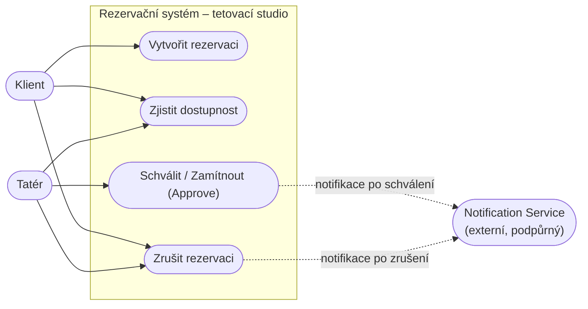
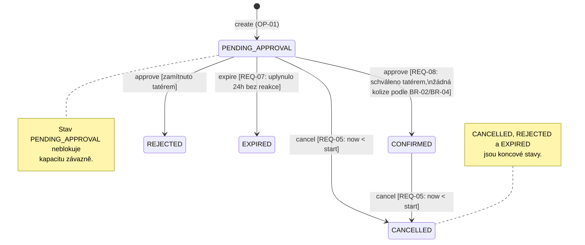
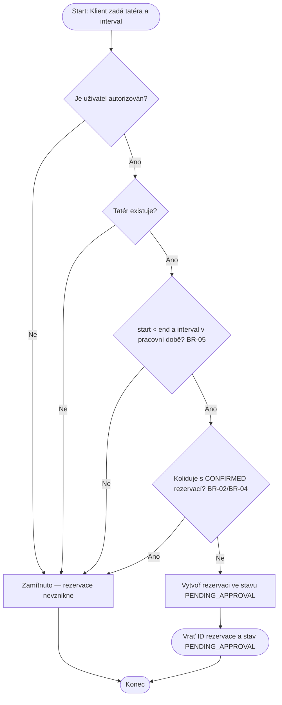
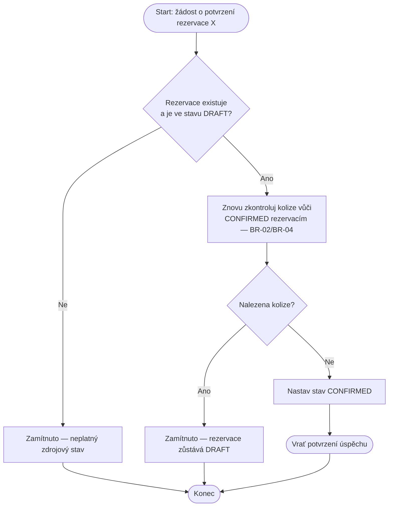
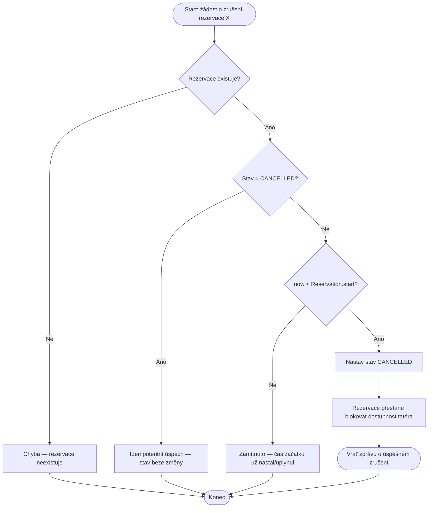
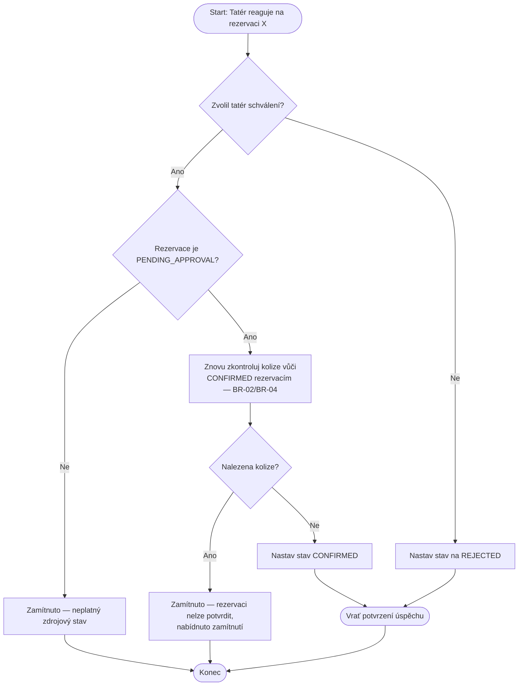

# Diagramy — Baseline v0.2

Tento dokument doplňuje textovou specifikaci (`reservation-create.md`,
`reservation-check-availability.md`, `reservation-approve.md`,
`reservation-cancel.md`, `reservation-rules.md`) o vizuální pohled na
systém, zohledňující změnu C02 (schvalovací proces).

---

## 9a — Diagram případů užití

Aktéři:
- **Klient** — vytváří rezervaci, zjišťuje dostupnost, ruší rezervaci.
- **Tatér** — schvaluje/zamítá rezervaci, zjišťuje dostupnost, může rezervaci zrušit.
- **Notification Service** — podpůrný externí aktér; dostává podnět po
  schválení nebo zrušení rezervace. Není to interní komponenta, proto je v diagramu.

Poznámky ke konzistenci:
- Operace Confirm zanikla jako samostatný uživatelský případ a stala se součástí procesu Approve (OP-05).
- Cancel má oba aktéry (Klient i Tatér), protože specifikace (BR-03) neomezuje zrušení jen na klienta.

---

## 9b — Stavový diagram životního cyklu Reservation

Kontrola konzistence s textem:
- Text nově počítá s tím, že rezervace po vytvoření čeká na schválení tatérem (přechod z Create do PENDING_APPROVAL).
- Text (OP-04, BR-03) umožňuje zrušit PENDING_APPROVAL i CONFIRMED před start → diagram má obě šipky do CANCELLED.

---

## 9c — Diagramy aktivit

### OP-01 — Create Reservation

### OP-02 — Check Availability

### OP-03 — Confirm Reservation

*Poznámka:* souběh (REQ-04) není v tomto lineárním diagramu vidět —
je to vlastnost celého systému při paralelních pokusech, ne jedné
instance běhu operace.

### OP-04 — Cancel Reservation

### OP-05 —  Approve Reservation

---

## Shrnutí kontroly konzistence

| Kontrola | Výsledek |
|---|---|
| Create vs. Approve | Create nealokuje Resource, závazná alokace vzniká až po kladném schválení v Approve — shodné s textem i diagramy. |
| Availability vs. Approve | PENDING_APPROVAL neblokuje dostupnost, blokuje ji až CONFIRMED. |
| Cancel vs. stavový diagram | Text i diagram shodně umožňují cancel z PENDING_APPROVAL i CONFIRMED před `start`. |
| Význam intervalů | Všude `[start, end)` dle BR-01. |
| Diagram případů užití vs. text | Nová operace OP-05 (Approve) je korektně zastoupena jako cíl tatéra, původní Confirm byl z Use Case diagramu odstraněn. |
