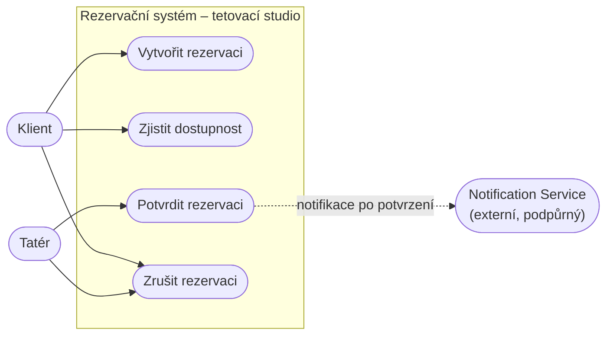
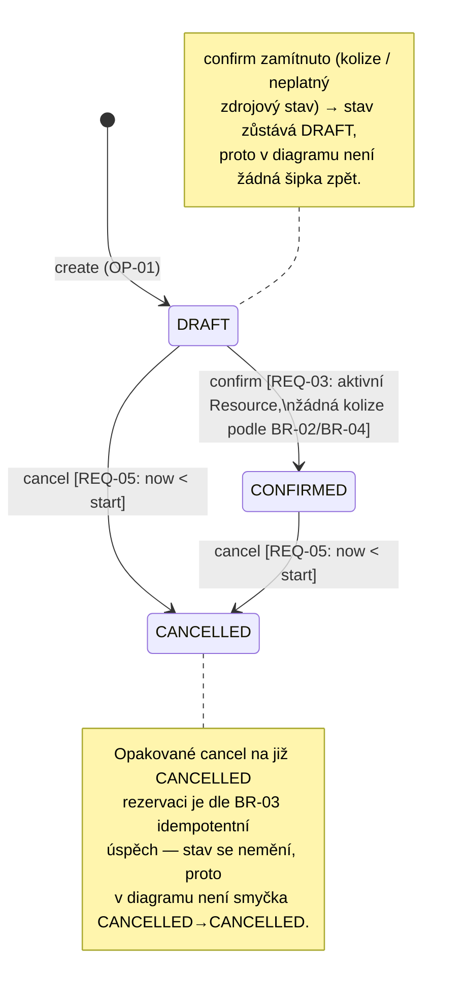
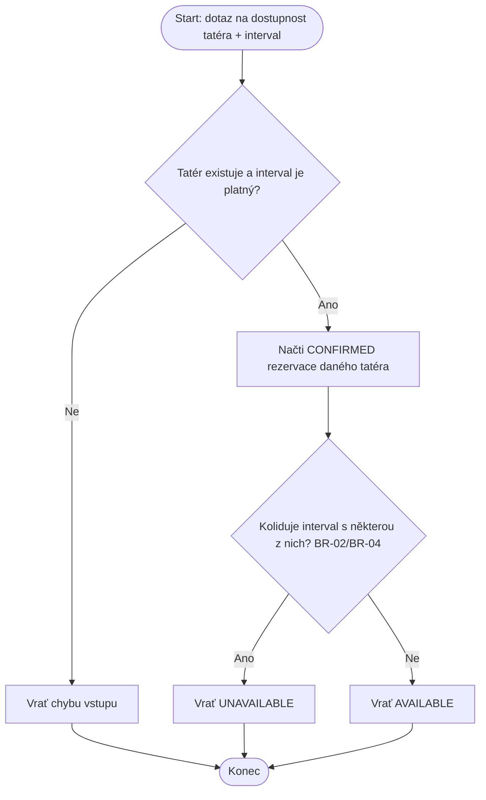

# Diagramy — Baseline v0.1

Tento dokument doplňuje textovou specifikaci (`reservation-create.md`,
`reservation-check-availability.md`, `reservation-confirm.md`,
`reservation-cancel.md`, `reservation-rules.md`) o vizuální pohled na
systém.

---

## 9a — Diagram případů užití

Aktéři:
- **Klient** — vytváří rezervaci, zjišťuje dostupnost, ruší rezervaci.
- **Tatér** — potvrzuje rezervaci, může rezervaci zrušit.
- **Notification Service** — podpůrný externí aktér; dostává podnět po
  potvrzení rezervace. Není to interní komponenta, proto je v diagramu.

Poznámky ke konzistenci:
- Čtyři cíle odpovídají přesně čtyřem operacím OP-01 až OP-04.
- Cancel má oba aktéry (Klient i Tatér), protože specifikace (BR-03)
  neomezuje zrušení jen na klienta — pokud by to tak v doméně nemělo být,
  je potřeba to v textu explicitně říct a diagram podle toho zúžit.
- Notification Service je jen navázaný na Confirm, ne na ostatní operace,
  protože to tak popisuje `intent-and-change.md`. Nejde o `include`/`extend`,
  jen o vazbu na externí systém.

---

## 9b — Stavový diagram životního cyklu Reservation

Kontrola konzistence s textem:
- Text (OP-04, BR-03) umožňuje zrušit DRAFT i CONFIRMED před `start` →
  diagram má obě šipky do CANCELLED. 
- Text nedovoluje cancel po/při `start` a nedovoluje confirm zpět do DRAFT
  → diagram žádné takové přechody nekreslí. 
- CANCELLED je koncový stav (žádné další přechody z něj nevedou).

---

## 9c — Diagramy aktivit

### OP-01 — Create Reservation

### OP-02 — Check Availability

### OP-03 — Confirm Reservation

*Poznámka:* souběh (REQ-04) není v tomto lineárním diagramu vidět —
je to vlastnost celého systému při paralelních pokusech, ne jedné
instance běhu operace.

### OP-04 — Cancel Reservation

---

## Shrnutí kontroly konzistence

| Kontrola | Výsledek |
|---|---|
| Create vs. Confirm | Create nealokuje Resource (jen kontroluje kolizi dopředu), závazná alokace vzniká až v Confirm — shodné s textem i diagramy. |
| Availability vs. Confirm | Obě operace považují za blokující stejné stavy: CONFIRMED + pravidlo pauzy BR-04 (DRAFT neblokuje). |
| Cancel vs. stavový diagram | Text i diagram shodně umožňují cancel z DRAFT i CONFIRMED, jen před `start`. |
| Význam intervalů | Všude `[start, end)` dle BR-01, ověřovací příklady v `reservation-check-availability.md` s tím počítají. |
| Diagram případů užití vs. text | Každý cíl aktéra (UC1–UC4) má odpovídající OP-01–OP-04 v textu; žádný „osiřelý" cíl. |
| Požadavek vs. návrhové rozhodnutí | Diagramy neobsahují technologie ani interní komponenty (žádné DB, třídy) — pouze chování. |
